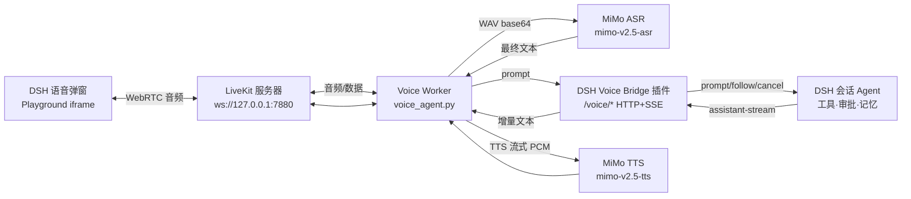

# LiveKitVoice — 实时语音对话系统（LiveKit + MiMo + DeepSeek Harness 语音桥插件）

一个跑在本机（Windows 优先验证）的实时语音对话系统：

- **耳朵和嘴巴**：LiveKit WebRTC 音频链路 + 小米 MiMo 的 ASR / TTS（OpenAI 兼容端点）。
- **大脑**：DeepSeek Harness（DSH）会话本身——工具调用、代码执行、审批、记忆、会话历史全部由 DSH 承担。
- **桥**：`dsh-voice-bridge` DSH Host 插件，在 DSH 的 Web 服务上暴露本地 HTTP/SSE 桥接口，并附带一个运行时管理器，一键拉起 LiveKit 服务器、Python Agent Worker 和 Next.js Playground。
- **界面**：DSH 会话头部的「语音」按钮弹出一个可拖动 / 最小化 / 调整大小的紧凑面板，内嵌 Playground；打开即自动连接房间并派发 Agent，无需手动点 Connect。

语音实时流（PCM）**不进入** DSH，DSH 只收发文本（用户转写文本 + Agent 回复流），因此 DSH 侧不需要任何音频基础设施。



## 目录结构

```
LiveKitVoice/
├── voice_agent.py            # LiveKit Agents 语音 Worker（STT/TTS/LLM 适配 + 工具）
├── memory.json               # 非 DSH 模式下的本地记忆（remember_fact 工具写入）
├── agent_workspace/          # write_code / run_script 工具的唯一可写目录
├── .env / .env.example       # Worker 与 Playground 的环境配置（模板见 .env.example）
├── livekit-server/           # 本地 LiveKit 服务器（Windows 二进制 + config.yml + 密钥）
├── agents-playground/        # Next.js 15 浏览器端（LiveKit 官方 Playground 定制版）
├── dsh-voice-bridge/         # DSH Host 插件：HTTP/SSE 桥 + 运行时管理器 + 客户端弹窗
│   ├── index.js              #   服务端：/voice/* 路由、运行时管理器
│   ├── client.js             #   客户端：会话头部「语音」按钮 + 可窗口化弹窗
│   ├── cordis.patch.yml      #   桌面 profile 的安装补丁（路径/端口/token 配置）
│   └── README.md             #   插件安装与使用说明
├── logs/                     # 运行时日志（LiveKit / Worker / Playground）
├── requirements.txt          # Python 依赖（pip install -r requirements.txt）
├── docs/
│   └── voice-bridge-api.md   # 语音桥 HTTP/SSE 接口参考
├── dsh-voice-plugin-feasibility.md  # 设计调研：为什么用 DSH 插件做桥（历史文档）
└── framework-comparison.md            # 框架对比调研（Hermes/OpenClaw/DSH，历史文档）
```

## 技术栈

| 组件 | 技术 | 说明 |
| --- | --- | --- |
| 音频传输 | LiveKit（`livekit-server` 1.13.x 本地二进制） | WebRTC，单节点 |
| Agent 框架 | LiveKit Agents（Python 1.8.8） | `AgentSession`、`TurnHandlingOptions`（VAD 端点化 + 打断） |
| VAD | silero（livekit 内置推理） | 语音活动检测，`min_silence_duration=1.0s`、打断 `min_duration=1.5s`（详见「语音交互行为」一节） |
| 耳朵（STT） | MiMo `mimo-v2.5-asr`（OpenAI 兼容 `/chat/completions`，WAV base64 进 content） | 非流式，按 VAD 切句 |
| 嘴巴（TTS） | MiMo `mimo-v2.5-tts`（同端点，assistant content 进文本，流式 base64 PCM16 @ 24kHz 出） | 200ms 预缓冲 + 20ms 帧；长回复按句拆成 ≤150 字符逐段合成再拼接（`TTS_CHUNK_LIMIT`），避免单次请求被截断 |
| 大脑（LLM） | DeepSeek Harness 会话（默认） | 经 `dsh-voice-bridge` HTTP/SSE 桥；可回退任意 OpenAI 兼容 LLM |
| 桥插件 | DSH Cordis Host 插件（Node ESM，注入 `webServer`/`sessionController`/`slots`） | 仅 loopback + token 鉴权 |
| 界面 | Next.js 15.5 + React 19 + pnpm（LiveKit Agents Playground 定制） | `livekit-client` 2.18 |

## 快速开始（本机已部署布局）

前置：Python 3.12（`.venv` 已建好）、Node 24 + npm、pnpm（corepack）、DSH 桌面端。

1. **LiveKit 服务器**：`livekit-server/livekit-server.exe --config livekit-server/config.yml`
   （或直接由插件运行时管理器拉起，见第 4 步；端口 7880，密钥见 `config.yml`。）
2. **Worker**：`F:\LiveKitVoice\.venv\Scripts\python.exe voice_agent.py dev`
   （依赖安装：`python -m venv .venv && .venv\Scripts\pip install -r requirements.txt`）
3. **Playground**：`cd agents-playground && pnpm install && pnpm run dev`（端口 3000；
   首次需把 `.env.example` 复制到 `.env.local` 并填 LiveKit 密钥。）
4. **DSH 插件**：通过 DSH 的插件页安装 `dsh-voice-bridge` bundle，并在桌面 profile 的
   `cordis.patch.yml` 中写入配置（路径、端口、`token`），重启 DSH 桌面端。
5. **使用**：在任意 DSH 会话头部点「语音」——运行时管理器会自动补齐缺失的
   livekit / worker / playground 三个进程，弹窗打开后自动连接房间、自动派发 Agent，
   直接开口说话即可。DSH 会话里能看到同一段对话（语音桥把转写文本 prompt 进该会话，
   Agent 回复流经 TTS 念出）。

> 端口注意：DSH 桌面端 Web 端口每次启动随机变化；由管理器拉起的 Worker 会自动拿到
> 当前端口（`DSH_VOICE_URL` 环境变量注入）。`.env` 里的 `DSH_VOICE_URL` 只是手动跑
> Worker 时的兜底值。

## 配置参考

### Worker / 共享 `.env`（`F:\LiveKitVoice\.env`）

| 变量 | 默认 | 说明 |
| --- | --- | --- |
| `MIMO_API_KEY` | 无 | MiMo 的 key，STT/TTS（以及 openai 回退模式下的 LLM）都用它 |
| `MIMO_BASE_URL` | `https://token-plan-cn.xiaomimimo.com/v1` | MiMo OpenAI 兼容端点 |
| `LLM_PROVIDER` | `dsh` | `dsh` = 走 DSH 语音桥（推荐）；`openai` = 直连任意 OpenAI 兼容 LLM |
| `DSH_VOICE_URL` | `http://127.0.0.1:3081` | DSH 桥地址；管理器拉起的 Worker 会自动注入当前端口，手跑时按实际 host 端口改 |
| `DSH_VOICE_TOKEN` | 空 | 必须与插件 `cordis.patch.yml` 的 `config.token` 一致；`LLM_PROVIDER=dsh` 时必填 |
| `DSH_VOICE_CWD` | 项目根 | 未绑定会话时自动创建隔离 DSH 会话用的工作目录 |
| `LLM_API_KEY` / `LLM_BASE_URL` / `LLM_MODEL` | MiMo key / `https://apihub.agnes-ai.com/v1` / `agnes-2.5-flash` | 仅 `LLM_PROVIDER=openai` 回退模式使用 |
| `LIVEKIT_URL` / `LIVEKIT_API_KEY` / `LIVEKIT_API_SECRET` | `ws://127.0.0.1:7880` / `devkey` / 见 `livekit-server/keys.txt` | 必须与 LiveKit 服务器一致 |

### DSH 插件 `cordis.patch.yml`（桌面 profile）

```yaml
- id: dsh-voice-bridge
  name: '@local/dsh-voice-bridge'
  config:
    token: <随机串，与 .env 的 DSH_VOICE_TOKEN 一致>
    projectRoot: 'F:/LiveKitVoice'
    livekitServer: 'F:/LiveKitVoice/livekit-server/livekit-server.exe'
    livekitConfig: 'F:/LiveKitVoice/livekit-server/config.yml'
    python: 'F:/LiveKitVoice/.venv/Scripts/python.exe'
    worker: 'F:/LiveKitVoice/voice_agent.py'
    playground: 'F:/LiveKitVoice/agents-playground'
    playgroundUrl: 'http://127.0.0.1:3000/'
    livekitPort: 7880
    playgroundPort: 3000
    npmCommand: 'C:/Program Files/nodejs/npm.cmd'
```

所有字段都有默认值（指向 `F:/LiveKitVoice` 布局），只有 `token` 必填。
运行时管理器的三个进程（livekit / worker / playground）只绑定 127.0.0.1。

### 模型与 API 配置（发布给其他用户时）

这是本项目最重要的一个设计点：**大脑（LLM）不在本项目里配置，而在 DSH 里配置。**

- **大脑**：语音桥把转写文本 prompt 进 DSH 会话，由 DSH 的 Agent 处理。用户在 DSH 的
  模型 Provider 设置里配好自己的模型（DSH 的 Custom Model API 支持任意 OpenAI 兼容
  端点：base URL + API key + 模型名），语音链路自动继承——插件侧没有任何模型配置。
- **耳朵/嘴巴**：STT/TTS 走 MiMo 的 `/chat/completions`（音频 base64 进、TTS 文本进
  assistant content），只需配 `MIMO_API_KEY`。换其他厂商的 ASR/TTS 需要替换
  `voice_agent.py` 里的 `MiMoSTT` / `MiMoTTS` 两个适配器（实现 LiveKit 的
  `STT` / `TTS` 接口即可，接口面很小）。
- **回退模式**：`LLM_PROVIDER=openai` + `LLM_API_KEY/LLM_BASE_URL/LLM_MODEL` 可完全
  绕开 DSH，用任意 OpenAI 兼容 LLM 当大脑（此时工具是 Worker 本地的
  `remember_fact/recall_memory/get_current_time/write_code/run_script`，无审批与记忆系统）。
- **LiveKit**：本地用自带的 `livekit-server` 二进制（`config.yml` 里的 keys）；
  用云端 LiveKit 则改 `.env` 的 `LIVEKIT_URL/KEY/SECRET` 与 Playground 的
  `.env.local`，并跳过管理器里的 livekit 拉起（端口不监听即自动跳过）。

## DSH 会话联动机制

1. DSH 会话头部「语音」按钮携带当前 `sessionId` 打开弹窗，iframe URL 为
   `http://127.0.0.1:3000/?dshSessionId=<sessionId>`。
2. Playground 读取该参数，把 LiveKit 房间名编码为 `dsh-<urlsafe-base64(sessionId)>`
   （见 `src/components/playground/Playground.tsx` 的 `roomNameForDshSession`）。
3. Worker 从房间名解码出 `sessionId`（`_dsh_session_from_room`），构造
   `DSHLLM(session_id=...)`：后续每一轮 `chat` 都把用户转写文本 POST 到
   `/voice/prompt` 并订阅 `/voice/follow`，回复增量文本交给 MiMo TTS；
   用户打断时（VAD）调用 `/voice/cancel` 停掉 DSH 当前轮次。
4. 没有 `dshSessionId` 时（普通房间名），Worker 调 `POST /voice/sessions` 创建一个
   隔离的 DSH 会话（`agentPreset: cordis`，cwd 为 `DSH_VOICE_CWD`）。
5. 提示词策略：Worker 会对每轮用户文本追加一句口语化汇报指令（见
   `DSHLLM.format_prompt`）——明确「该调工具正常调，最后口头汇报才要简短无
   Markdown」，避免语音风格指令压制 DSH 侧的工具执行。

## 语音交互行为（回合、灵敏度、打断）

语音链路里「什么时候算你说完了」「声音小/环境吵怎么办」「能不能插话」由
`voice_agent.py` 里的一组参数决定（`inference.VAD` + `TurnHandlingOptions`）。
当前取值与含义如下，改完重启 worker 生效。

### 1. 何时判定「说完了一轮」（回合切分）

- **VAD（silero）`min_silence_duration=1.0s`**：持续 1 秒静音才判一句说完。
  句中停顿 < 1s 不会把一句话切碎；这是「长段落能被完整识别」的关键。
  代价：你真正说完后，系统要多等约 1s 才起反应。
- **`endpointing`（fixed 模式）`min_delay=1.5s` / `max_delay=4.0s`**：判出停顿后
  继续等的窗口。你在这个窗口内接着说，就并入**同一轮**，整段一次转写给 MiMo ASR；
  超过 `max_delay` 仍没继续，则以当前累积文本生成回复。
  → 效果：正常语速连说十几秒没问题；但刻意停顿超过 4s 会被当成「这轮结束了」。
- **`max_buffered_speech=60s`（VAD 默认）**：单轮最多缓存 60s 语音，超过丢弃后续，
  一般用不到。

### 2. 声音灵敏度（VAD 概率阈值）

- **`activation_threshold=0.5`（当前用默认）**：silero 每 32ms 窗口输出「这是人声」的
  概率 0~1；≥0.5 累计够 `min_speech_duration=0.05s` 判「开始说话」，
  回落时 `deactivation_threshold=0.35`（激活阈值 −0.15）判「这轮声音结束」。
- **说话声音偏轻 / 离麦克风远 / 识别不到**：把 `activation_threshold` 调**低**
  （如 0.35~0.4），更灵敏。
- **背景音、别人说话、风扇声误触发**：把它调**高**（如 0.55~0.65），更抗噪。
- 调法：`inference.VAD(model="silero", activation_threshold=0.4)`。
  它**不通过 `.env`**，是 worker 启动时写死在代码里的——要改就改 `voice_agent.py`。

### 3. 打断（barge-in）支持情况

**支持**，且是 VAD 驱动的实时打断（不是等我说完才处理）：

- **`interruption.mode="vad"` + `min_duration=1.5s`**：我在播报时，你连续说话 ≥1.5s
  才触发打断——单个「嗯」「哦」（通常 <1.2s）不会打断长播报，你真正要插话
  （连说 1.5s+）才会打断：我停止当前 TTS 播报、调 `/voice/cancel` 取消 DSH 里正在
  跑的那一轮，然后把你打断我的话转写并继续处理。
- **误打断保护**：`resume_false_interruption=True` +
  `false_interruption_timeout=2.0s`：如果其实是误打断（比如轻咳），2s 内没有后续
  实质内容就恢复被打断的那段继续说。
- **`backchannel_boundary=(1.0, 1.5)`**：LiveKit 原生的附和窗口——只在我**开口后
  头 1s**（`start_cooldown`）内的用户短语音按附和处理、不当打断。长播报**中途**
  的「嗯」不在这个窗口里，靠的是上面的 `min_duration=1.5` 把它们挡在打断阈值之下。
- 打断后 DSH 会话里那一轮会被 `cancel`，`/voice/follow` 会收到
  `turn/end`（取消型），worker 据此不再继续念旧回复。

### 4. 实际效果（你听到的行为）

- 你正常说一段（句间停顿 <1s）→ 我等你停 ~1s、再多等 1.5s 确认你说完了 →
  整段一次识别、一次回复。
- 我播报中你插话（连续 ≥1.5s）→ 我立刻闭嘴听你，转写你的话继续对话；
  你只随口「嗯」「哦」（<1.5s）不会打断。
- 你安静超过 4s 再开口 → 算新一轮。

### 5. 调参速查

| 现象 | 改哪个 | 方向 |
| --- | --- | --- |
| 长句被切碎 / 只识别到最后一句 | `min_silence_duration` / `endpointing.max_delay` | 调大 |
| 说完后反应太慢 | `min_silence_duration` / `endpointing.min_delay` | 调小 |
| 声音小识别不到 | `activation_threshold` | 调低（0.35~0.4） |
| 环境吵误触发 | `activation_threshold` | 调高（0.55~0.65） |
| 插话打不断我 | `interruption.min_duration` | 调小（1.0~1.2） |
| 我总被「嗯/哦」误打断 | `interruption.min_duration` | 调大（当前 1.5） |
| 长回复播报到一半没声了 | TTS 分段（`TTS_CHUNK_LIMIT`） | 已内置按句拆分，一般无需改 |

## 弹窗交互（`dsh-voice-bridge/client.js`）

- 拖动：按住标题栏（展开态与最小化态均可）移动整个面板；
- 调整大小：右下角 28px 斜纹握把（宽高同调）+ 底边 8px 条（调高度），带 `cursor` 提示；
- 最小化：标题栏 `—` 收成 180×44 小条，iframe 常驻不卸载，LiveKit 连接与房内 Agent
  保持运行，声音继续；
- 记忆：位置/尺寸存 `localStorage`（`dsh-voice-popup-pos` / `dsh-voice-popup-size`）；
- 自动连接：iframe 带 `dshSessionId` 时 Playground 自动 `session.start()`，
  无需手动点 Connect（`agents-playground/src/pages/index.tsx`）。

## 语音桥 HTTP 接口（摘要）

完整参考见 [`docs/voice-bridge-api.md`](docs/voice-bridge-api.md)。

| 端点 | 方法 | 鉴权 | 说明 |
| --- | --- | --- | --- |
| `/voice/health` | GET | 无 | 桥状态 |
| `/voice/sessions` | GET / POST | token | 列 / 建 DSH 会话 |
| `/voice/prompt` | POST | token | `{sessionId, text, mode: queue\|steer}` 提交一轮 |
| `/voice/cancel` | POST | token | 取消该会话当前轮次 |
| `/voice/follow?sessionId=` | GET(SSE) | token | 流式回传 assistant 增量与 turn 事件 |
| `/voice/runtime/status` | GET | loopback | 管理器状态（phase/进程/最近日志） |
| `/voice/runtime/start` | POST | loopback | 幂等拉起缺失的 livekit/worker/playground |
| `/voice/runtime/stop` | POST | loopback | 停止管理器拉起的进程 |

## 常见问题

- **弹窗白屏**：Playground 编译失败（常见于 pnpm 严格隔离模式下
  `next-plugin-preval` 依赖的 Babel 插件没被提升）。本项目已把
  `@babel/core`、`@babel/preset-env`、`@babel/preset-typescript`、
  `@babel/register`、`babel-plugin-module-resolver` 加入
  `agents-playground/package.json` 的 devDependencies 解决；重装依赖后生效。
- **DSH 重启后 Worker 连不上桥**：host 端口变了。管理器拉起的 Worker 自动跟随；
  手跑的 Worker 需要按新端口重启（或改 `.env`）。
- **没有声音输出**：依次检查 ① 弹窗/iframe 是否自动播放被浏览器拦（需允许
  autoplay）② Worker 日志有无 `MiMo TTS returned no audio data` ③ DSH 会话是否
  真的收到 prompt（`/voice/follow` 有没有 text-delta 帧）。
- **LiveKit 房间名必须保持 `dsh-` 前缀约定**：改名会导致 Worker 无法解码会话，
  退化为创建隔离会话。
- **审批策略**：DSH 会话沿用 DSH 自己的文件策略与审批设置（本项目当前为
  `danger-full-access` + 免审批），语音链路不额外叠加审批。

## 发布到 GitHub 前清单

- [ ] 用 `.env.example`（占位符版）替代真实 `.env`；`livekit-server/keys.txt`、
      `secret.txt`、`.env` 不进仓库（`.gitignore` 已含 `.env`）。
- [ ] 提供 `requirements.txt`（本仓库已附）与一键安装脚本（`pip install -r` +
      `pnpm install` + 拷贝 `.env` 模板）。
- [ ] `dsh-voice-bridge/cordis.patch.yml` 的路径改为相对/可配置说明，避免写死
      `F:/LiveKitVoice`。
- [ ] 说明 DSH 插件安装方式（DSH 插件页安装 bundle + profile 补丁 + 重启 DSH）。
- [ ] 可选：把 STT/TTS provider 抽成环境变量，降低新用户必须用 MiMo 的门槛。

## 设计背景文档

- `dsh-voice-plugin-feasibility.md`：为什么选择「DSH Host 插件 + LiveKit 传输层」的
  方案边界、DSH 接口（prompt/cancel/follow）与协议草案。
- `framework-comparison.md`：OpenClaw / Hermes / DeepSeek Harness 三个框架对照，
  以及「保留 LiveKit+MiMo 语音壳、DSH 做工具内核」的决策依据。
