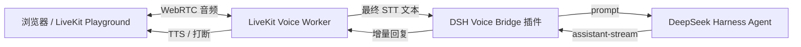

# DeepSeek Harness 语音桥接插件可行性

调查日期：2026-10-18。结论基于 `deepseek-ai/deepseek-harness` 官方仓库、官方文档和本机安装信息。

## 结论

可行，但应实现为 **DeepSeek Harness Host 插件 + LiveKit 语音传输层**，不应把实时音频做成一次普通的 LLM tool call。

推荐职责边界：

- DeepSeek Harness：会话、上下文、模型、工具调用、审批、记忆和会话日志。
- LiveKit Worker：麦克风、VAD、语音结束判断、打断、MiMo STT 和 MiMo TTS。
- DSH 插件：在本机提供经过认证的 WebSocket/HTTP 桥，调用 DSH 的 prompt、cancel 和 follow 接口。

DSH 中不需要传输或保存实时 PCM 音频，只传输最终或增量文本。



## 已确认的 DSH 能力

### 已有语音输入，但不是完整语音对话

DSH 官方已经提供实验性语音输入 Bundle：

- 浏览器录制完整 WAV，通过认证 Remote 发送到 Host。
- 默认使用本地 SenseVoice Provider 做语音识别。
- 识别结果只插入普通输入框草稿，用户必须再次提交。
- 官方文档明确说明识别本身不写入 Session，也不会激活或提交 Agent。
- 当前实现是 16 kHz 单声道 PCM16、完整录音转写，不是流式 ASR。
- 没有发现 TTS、语音输出、实时打断或 LiveKit 集成。

来源：

- [语音输入子系统](https://github.com/deepseek-ai/deepseek-harness/blob/master/docs/subsystems/voice-input.zh.md)
- [实验性语音输入 Bundle](https://github.com/deepseek-ai/deepseek-harness/blob/master/packages/experimental/voice-input-bundle/README.zh.md)
- [实验性 STT Remote](https://github.com/deepseek-ai/deepseek-harness/blob/master/packages/experimental/api-speech-to-text/README.zh.md)

因此，现有 DSH 语音输入适合作为文字输入模式，不能直接替代当前 LiveKit 的实时对话、TTS 和 barge-in。

### 插件可承载本地实时桥

DSH 的 `ctx.webServer` 支持：

- 注册普通 HTTP route。
- 注册 HTTP upgrade route，可用于 WebSocket。
- 插件拥有完整响应生命周期，包括长连接和流式响应。
- Web Server 本身不认识 Agent 概念，具体 prompt、流式回复和取消由插件实现。

来源：

- [HTTP 服务器子系统](https://github.com/deepseek-ai/deepseek-harness/blob/master/docs/subsystems/web-server.zh.md)
- [Host 插件开发参考](https://github.com/deepseek-ai/deepseek-harness/blob/master/packages/preset/agent-preset/skills/cordis-plugin-development/references/host-plugin.md)

### 会话控制接口适合语音桥

DSH Session Controller 已公开三类关键操作：

- `prompt`：提交一个 Session 的用户消息，并等待 Agent 接受。
- `cancel`：取消当前活跃轮次，同时保留待处理 inbox。
- `follow`：流式跟踪 Session 日志和 assistant stream。

Agent 生命周期文档还明确了 `followup`、`agent/assistant-stream`、运行状态和轮次取消的关系。

来源：

- [Session 子系统](https://github.com/deepseek-ai/deepseek-harness/blob/master/docs/subsystems/session.zh.md)
- [Agent 轮次与步骤生命周期](https://github.com/deepseek-ai/deepseek-harness/blob/master/docs/agent-lifecycle.zh.md)

这组接口足以完成：

1. LiveKit 得到最终 STT 后调用 `prompt`。
2. 插件持续读取 `assistant-stream`，把增量文本发回 LiveKit。
3. 用户说话并触发打断时调用 `cancel`。
4. 回复到达稳定句子边界后交给 MiMo TTS。
5. DSH 正常执行工具调用、审批和记忆，LiveKit 不重复实现这些能力。

## 推荐实现方式

### 方案 A：Custom LLM Bridge，推荐先做

保留现有 `voice_agent.py`、LiveKit、MiMo STT/TTS 和 turn handling，把其中的 Agnes LLM 替换为一个 `DSHLLM` 适配器：

1. LiveKit 仍负责把用户语音变成最终文本。
2. `DSHLLM.chat()` 把用户消息发送到 DSH 插件的 WebSocket。
3. DSH 插件调用 `prompt` 并订阅 `assistant-stream`。
4. 插件把增量 token 返回给 `DSHLLM`，由 LiveKit 生成回复语音。
5. LiveKit 检测到用户打断时，向插件发送 `cancel`。

优点是改动集中，可以保留当前已经调通的音频链路，也能获得 DSH 的工具、记忆、审批和会话历史。

需要注意：工具调用应由 DSH 完成。LiveKit 不应再把自己的 `write_code`、`run_script` 等工具 schema 重复发送给 DSH，否则会形成两套工具系统。

### 方案 B：把现有 Playground 整体替换为 DSH Web UI

让 DSH 成为主界面，LiveKit 只作为浏览器旁边运行的音频节点。这个方案能直接使用 DSH 的 Session 页面和工具审批 UI，但需要额外开发：

- 浏览器音频采集和 LiveKit 连接 UI。
- DSH 会话选择与 LiveKit participant/session 绑定。
- 模型流到 TTS 的路由。
- 打断、重连、错误恢复和多会话路由。

工作量明显高于方案 A，适合作为第二阶段。

## 插件协议草案

WebSocket 消息建议使用 JSON：

```json
{"type":"hello","session_id":"session-1","token":"..."}
{"type":"prompt","text":"帮我检查当前目录"}
{"type":"cancel"}
{"type":"assistant_delta","text":"正在检查"}
{"type":"assistant_end","finish_reason":"stop"}
{"type":"tool_status","status":"running"}
{"type":"error","message":"..."}
```

约束：

- 只绑定 `127.0.0.1`。
- 握手必须校验一次性 token、Origin 和 WS Upgrade。
- 每个 LiveKit room/participant 只允许绑定一个明确的 DSH Session。
- `prompt`、`cancel` 和 `follow` 都使用超时与 AbortSignal。
- TTS 只接收稳定句子片段，避免逐 token 合成造成重复和延迟。
- 打断时同时停止当前 TTS、取消 LiveKit 回复任务，并调用 DSH `cancel`。
- 工具运行状态只在确有用户价值时转成短语音，详细工具输出保留在 DSH UI。

## 实施顺序

1. 在 DSH 中安装一个最小 Host 插件，只提供 `/voice/health` 和认证握手。
2. 用固定 Session 验证 `prompt -> assistant-stream -> cancel` 全链路。
3. 写 `DSHLLM` 适配器，让现有 LiveKit Worker 暂时只做文字桥接。
4. 接入 MiMo TTS 和句子切分。
5. 接入 VAD 打断，并验证 cancel 后不会继续播放旧回复。
6. 最后再做会话选择、自动重连、多房间和 DSH Web UI 联动。

插件必须通过 DSH 的 `plugin_manager.install_bundle` 安装，不直接修改 `$DSH_HOME` 或 profile 配置文件。

## 风险

- DSH 当前语音插件是实验功能，但桥接所依赖的 webServer、prompt、cancel 和 follow 属于独立接口。
- 本机 DSH 是 `0.2.1-rc.2`，插件 API 应以运行中的 `cordis_inspect_query` 结果为准。
- 尚未在运行的 DSH 中核对认证、Remote 参数和具体 Session id 获取方式，这些必须作为第一步实测。
- DSH 没有确认内置 TTS；语音输出仍应由现有 MiMo TTS 承担。
- “DeepSeek Hermes”不是已确认的合并框架。DeepSeek Harness 和 Nous Research Hermes Agent 是两个独立项目。

## 最终建议

采用方案 A：**保留 LiveKit + MiMo 作为耳朵和嘴巴，新增 DeepSeek Harness Voice Bridge 插件作为会话与工具内核。**

这比继续把记忆、代码执行、审批和搜索逐步塞进 `voice_agent.py` 更容易扩展，也比直接重做 DSH 前端风险低。
